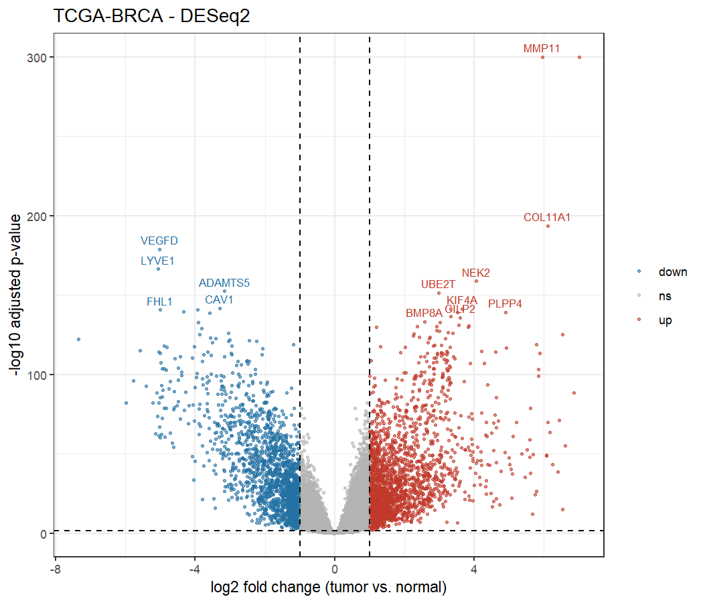
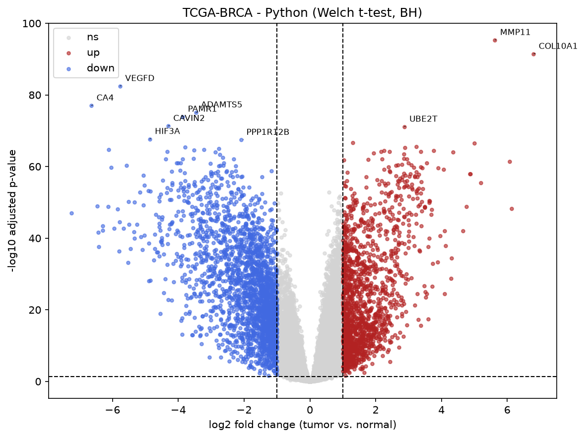
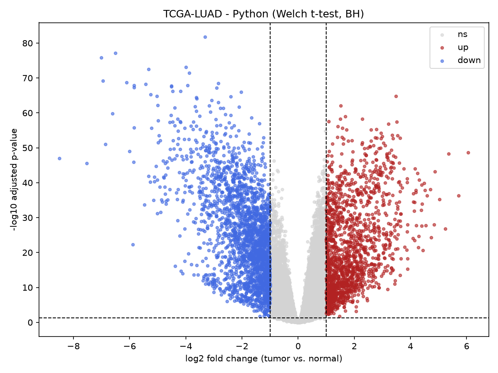

# cancer-dgea-tool

Differential gene expression analysis (DGEA) of tumor vs. normal tissue in two
TCGA cancers: breast invasive carcinoma (BRCA) and lung adenocarcinoma (LUAD).
The data pipeline (cleaning, filtering, normalization) is in R. The analysis is
done two ways and compared: DESeq2 in R, and log2 fold change with a per-gene
Welch t-test and Benjamini-Hochberg correction in Python. Each produces a
ranked gene table and a volcano plot per cancer.

CS-123A term project. Team: Enzo Villar (data pipeline), Daniel Lopez (analysis).

## Quick start

Everything needed to reproduce the results is in this repo, including a small
data sample. No downloads are required.

```bash
git clone https://github.com/viriescence/cancer-dgea-tool.git
cd cancer-dgea-tool
Rscript run_all.R
```

This takes about two minutes. It reads `data/sample/`, normalizes the counts,
writes the analysis input files to `data/processed/`, and runs DESeq2 to write a
ranked gene table and a volcano plot per cancer to `results/`.

## Requirements

- R 4.3 or newer (developed on 4.6.0)
- The `edgeR` and `DESeq2` packages, plus `ggplot2`:

```r
install.packages(c("BiocManager", "ggplot2"))
BiocManager::install(c("edgeR", "DESeq2"))
```

- Python 3 with the packages in `python/requirements.txt`:

```bash
pip install -r python/requirements.txt
```

## Repository layout

```
run_all.R             entry point for the R pipeline
R/load_data.R         download, label, filter, normalize, sample, export
R/deseq2.R            DESeq2 differential expression (reference method)
R/plots.R             volcano plot
R/validate.R          enrichment of known cancer genes among significant genes
run_validation.R      runs the validation on the tables in results/tables/
python/dgea.py        differential expression analysis (Python)
python/requirements.txt
data/sample/          committed data: all normals + 150 tumors per cancer
data/processed/       log2 CPM, groups and genes per cancer: input for python/dgea.py
                      (written by run_all.R, committed so Python runs without R)
data/raw/             full TCGA download (not tracked)
results/tables/       ranked gene tables
results/figures/      volcano plots
reference/            known cancer genes used for validation
```

## Data

Gene expression comes from The Cancer Genome Atlas (TCGA), obtained through the
NCI Genomic Data Commons (GDC) as open-access STAR raw counts (hg38).

| Cancer | Normal samples | Tumor samples (full) | Tumor samples (in `data/sample/`) |
|--------|---------------:|---------------------:|----------------------------------:|
| BRCA   | 113            | 1,095                | 150                               |
| LUAD   | 59             | 517                  | 150                               |

Preprocessing (`R/load_data.R`):

1. Keep primary tumors and solid-tissue normals; label them `tumor` / `normal`.
2. Keep one sample per patient per group, so samples are independent.
3. Keep protein-coding genes.
4. Drop low-expression genes: CPM > 1 in at least as many samples as the
   smallest group (15,319 genes remain for BRCA, 15,539 for LUAD).
5. Normalize with TMM and convert to log2 CPM.

`data/sample/` holds the filtered raw counts for all normal samples plus a
random subset of 150 tumors per cancer (seed 123). It is small enough to commit
and is what `Rscript run_all.R` uses by default.

### Other cancers or your own data

The pipeline is not tied to BRCA and LUAD. Any TCGA project with at least 3
tumor and 3 normal samples works (for example `TCGA-COAD`, `TCGA-KIRC`,
`TCGA-LIHC`; projects with almost no normal tissue, such as `TCGA-GBM`, cannot).

```bash
Rscript run_all.R TCGA-COAD
```

If `data/sample/` has no files for that project, the script downloads it from
the GDC (needs `TCGAbiolinks` and `SummarizedExperiment`, see below), keeps all
normals plus 150 random tumors, saves them to `data/sample/`, and runs the
analysis on them. Several projects can be listed at once.

To analyze a dataset that is not from TCGA, add three files to `data/sample/`
using any name (here `mydata`) and run `Rscript run_all.R mydata`:

| File                    | Contents                                                           |
|-------------------------|--------------------------------------------------------------------|
| `mydata_counts.csv.gz`  | raw integer counts, genes as rows, samples as columns, row names = gene IDs |
| `mydata_groups.csv`     | columns `sample_id`, `group`; `group` is `tumor` or `normal`       |
| `mydata_genes.csv`      | column `gene_id`; optional `gene_name`, `gene_type`                |

### Reproducing from the full TCGA data (optional)

This downloads about 10 GB per cancer, needs an internet connection, and
rebuilds `data/sample/` from scratch (the analysis then runs on that sample):

```r
BiocManager::install(c("TCGAbiolinks", "SummarizedExperiment"))
```

```bash
Rscript run_all.R --full
```

## Running the analysis

1. `Rscript run_all.R` writes, for each cancer, to `data/processed/`:
   - `<project>_logcpm.csv.gz`: genes x samples, log2 CPM
   - `<project>_groups.csv`: sample ID and `tumor` / `normal`
   - `<project>_genes.csv`: Ensembl ID, gene name, gene type
2. It also writes `results/tables/<project>_deseq2.csv` and
   `results/figures/<project>_deseq2_volcano.png` (DESeq2, up/down at adjusted
   p < 0.05 and |log2 fold change| >= 1).
3. Python analysis, from the project root:

   ```bash
   pip install -r python/requirements.txt
   python3 python/dgea.py
   ```

   It reads the three files in `data/processed/` (committed, so R is not needed
   for this step) and writes `results/tables/<project>_ranked_genes.csv` and
   `results/figures/<project>_volcano_plot.png`. To run it without installing
   anything, open
   [`python/Cancer-Gene-Reg.ipynb`](https://colab.research.google.com/github/viriescence/cancer-dgea-tool/blob/main/python/Cancer-Gene-Reg.ipynb)
   in Google Colab and choose Runtime > Run all.

## Methods

Preprocessing is described under [Data](#data). Differential expression is run
two ways on the same samples:

- **DESeq2 (R, `R/deseq2.R`):** negative-binomial model on raw counts with
  design `~ group`, contrast tumor vs. normal, Benjamini-Hochberg adjusted
  p-values.
- **Python (`python/dgea.py`):** log2 fold change as the difference of mean
  log2 CPM between tumor and normal, Welch's two-sample t-test per gene, and
  Benjamini-Hochberg correction across all genes.

Genes are called up or down in tumor at adjusted p < 0.05 and
|log2 fold change| >= 1.

## Results

Output of `Rscript run_all.R` on the committed sample, using DESeq2 (tumor vs.
normal; up/down = adjusted p < 0.05 and |log2 fold change| >= 1). The ranked
tables are in `results/tables/` and the plots in `results/figures/`.

| Cancer | Genes tested | Up in tumor | Down in tumor | Top genes                          |
|--------|-------------:|------------:|--------------:|------------------------------------|
| BRCA   | 15,319       | 2,061       | 1,650         | MMP11, COL10A1, COL11A1, VEGFD     |
| LUAD   | 15,539       | 2,409       | 1,585         | PYCR1, FAM83A, OTUD1, ETV4         |




### Python (Welch t-test)

Output of `python3 python/dgea.py` on the same samples.

| Cancer | Genes tested | Up in tumor | Down in tumor | Top genes                   |
|--------|-------------:|------------:|--------------:|-----------------------------|
| BRCA   | 15,319       | 1,451       | 2,168         | MMP11, COL10A1, VEGFD, CA4  |
| LUAD   | 15,539       | 1,547       | 2,297         | STX11, AGER, ITLN2, CAV1    |




### Comparison of the two methods

| Cancer | log2 fold change correlation | Top-500 genes in common | Called up by both | Called down by both |
|--------|-----------------------------:|------------------------:|------------------:|--------------------:|
| BRCA   | 0.93                         | 358                     | 1,393             | 1,586               |
| LUAD   | 0.91                         | 274                     | 1,544             | 1,571               |

The two methods agree on direction and size of change for most genes. They
differ in which genes rank highest: DESeq2 models raw counts with a
negative-binomial distribution, while the t-test works on log2 CPM and assumes
roughly normal values. DESeq2 calls more genes up and fewer down than the
t-test, and the overlap of the top 100 genes is 60 for BRCA and 30 for LUAD.
Both methods rank known tumor-associated genes such as MMP11 and COL10A1
(BRCA) near the top.

### Validation against known cancer genes

As an independent check, we asked whether genes with known roles in cancer are
more likely to be called significant than other genes. The reference list is the
638 genes in CIViC (CC0; see `reference/README.md`). After running both
analyses, `Rscript run_validation.R` writes
`results/tables/known_gene_validation.csv`.

| Cancer | Method | Known genes significant | Other genes significant | p (all genes) | Known genes in top 500 (expected 19) | p (top 500) |
|--------|--------|------------------------:|------------------------:|--------------:|--------------------------------------:|------------:|
| BRCA   | DESeq2 | 29.7%                   | 24.0%                   | 0.0018        | 29                                    | 0.033       |
| BRCA   | Python | 28.6%                   | 23.4%                   | 0.0043        | 27                                    | 0.077       |
| LUAD   | DESeq2 | 29.9%                   | 25.5%                   | 0.020         | 42                                    | 2.6e-6      |
| LUAD   | Python | 28.9%                   | 24.6%                   | 0.018         | 31                                    | 0.0094      |

Known cancer genes are modestly but consistently enriched among significant
genes in both cancers and with both methods (Fisher's exact test). The
enrichment among the 500 most significant genes is strongest for LUAD with
DESeq2 and weakest for BRCA with the t-test, where it is not significant at
0.05. Among the strongest known-gene hits are the cell-cycle genes PLK1, AURKA,
PTTG1 and RRM2 in BRCA, and ETV4, TOP2A, BIRC5 and PLK1 in LUAD, all
up-regulated in tumor.

The effect is small because CIViC lists genes with clinical evidence across all
cancer types, not drivers specific to breast or lung, and because about a
quarter of all genes pass the significance thresholds in these large cohorts.

## Contributions

- **Enzo Villar:** dataset selection, data download and cleaning, sample
  labeling, filtering, normalization, repository and run script.
- **Daniel Lopez:** differential expression analysis, ranked tables, volcano plots.
- **Both:** validation against known cancer genes, README, presentation.

## License and data use

Code is released under the MIT license (see `LICENSE`). TCGA data are open
access from the GDC. Please cite the TCGA Research Network
(https://www.cancer.gov/tcga) when reusing them.
