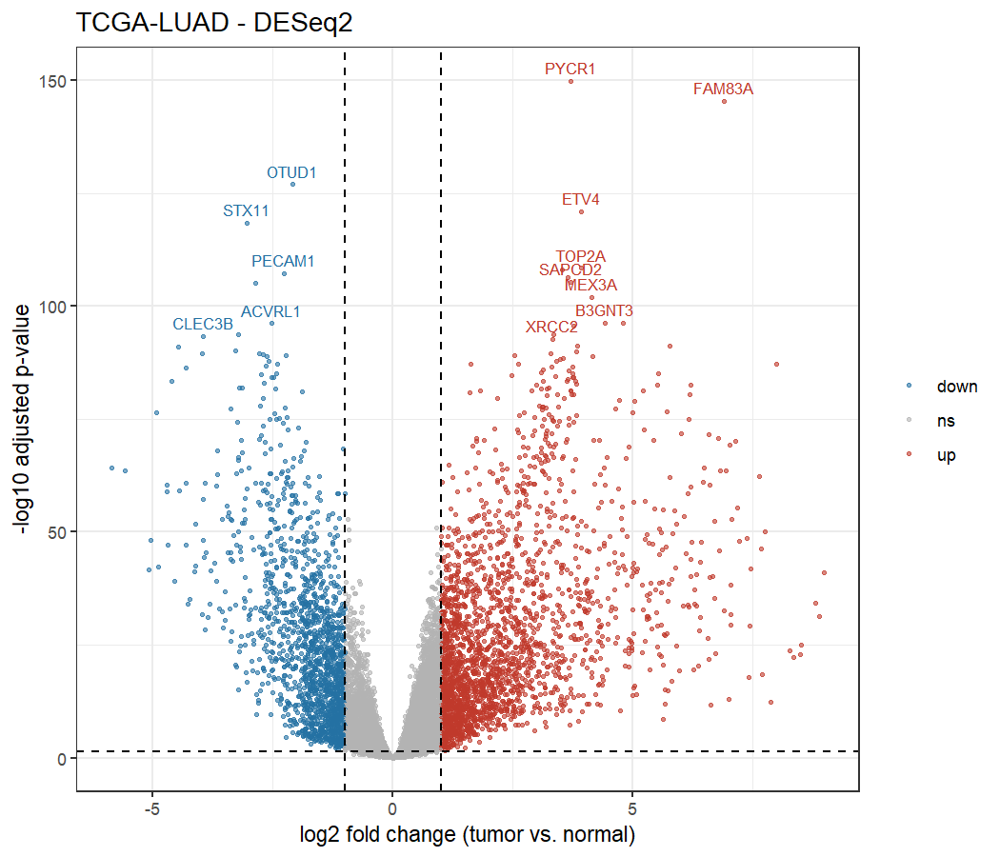

# cancer-dgea-tool

Differential gene expression analysis (DGEA) of tumor vs. normal tissue in two
TCGA cancers: breast invasive carcinoma (BRCA) and lung adenocarcinoma (LUAD).
The data pipeline is in R; the statistical analysis (log2 fold change, per-gene
t-test, multiple-testing correction, ranked tables, volcano plots) is in Python.

CS-123A term project. Team: Enzo Villar (data pipeline), Daniel Lopez (analysis).

## Quick start

Everything needed to reproduce the results is in this repo, including a small
data sample. No downloads are required.

```bash
git clone https://github.com/viriescence/cancer-dgea-tool.git
cd cancer-dgea-tool
Rscript run_all.R
```

This takes about two minutes. It reads `data/sample/`, normalizes the counts,
writes the analysis input files to `data/processed/`, and runs DESeq2 to write a
ranked gene table and a volcano plot per cancer to `results/`.

## Requirements

- R 4.3 or newer (developed on 4.6.0)
- The `edgeR` and `DESeq2` packages, plus `ggplot2`:

```r
install.packages(c("BiocManager", "ggplot2"))
BiocManager::install(c("edgeR", "DESeq2"))
```

- Python 3 with the packages in `python/requirements.txt`:

```bash
pip install -r python/requirements.txt
```

## Repository layout

```
run_all.R             entry point for the R pipeline
R/load_data.R         download, label, filter, normalize, sample, export
R/deseq2.R            DESeq2 differential expression (reference method)
R/plots.R             volcano plot
python/dgea.py        differential expression analysis (Python)
python/requirements.txt
data/sample/          committed data: all normals + 150 tumors per cancer
data/processed/       generated by run_all.R (not tracked)
data/raw/             full TCGA download (not tracked)
results/tables/       ranked gene tables
results/figures/      volcano plots
reference/            known cancer genes used for validation
```

## Data

Gene expression comes from The Cancer Genome Atlas (TCGA), obtained through the
NCI Genomic Data Commons (GDC) as open-access STAR raw counts (hg38).

| Cancer | Normal samples | Tumor samples (full) | Tumor samples (in `data/sample/`) |
|--------|---------------:|---------------------:|----------------------------------:|
| BRCA   | 113            | 1,095                | 150                               |
| LUAD   | 59             | 517                  | 150                               |

Preprocessing (`R/load_data.R`):

1. Keep primary tumors and solid-tissue normals; label them `tumor` / `normal`.
2. Keep one sample per patient per group, so samples are independent.
3. Keep protein-coding genes.
4. Drop low-expression genes: CPM > 1 in at least as many samples as the
   smallest group (15,319 genes remain for BRCA, 15,539 for LUAD).
5. Normalize with TMM and convert to log2 CPM.

`data/sample/` holds the filtered raw counts for all normal samples plus a
random subset of 150 tumors per cancer (seed 123). It is small enough to commit
and is what `Rscript run_all.R` uses by default.

### Reproducing from the full TCGA data (optional)

This downloads about 10 GB, needs an internet connection, and rebuilds
`data/sample/` from scratch:

```r
BiocManager::install(c("TCGAbiolinks", "SummarizedExperiment"))
```

```bash
Rscript run_all.R --full
```

## Running the analysis

1. `Rscript run_all.R` writes, for each cancer, to `data/processed/`:
   - `<project>_logcpm.csv.gz`: genes x samples, log2 CPM
   - `<project>_groups.csv`: sample ID and `tumor` / `normal`
   - `<project>_genes.csv`: Ensembl ID, gene name, gene type
2. It also writes `results/tables/<project>_deseq2.csv` and
   `results/figures/<project>_deseq2_volcano.png` (DESeq2, up/down at adjusted
   p < 0.05 and |log2 fold change| >= 1).
3. Python analysis: _TODO (Daniel): command and expected outputs._

## Methods

_TODO (Daniel): log2 fold change, test, multiple-testing correction, thresholds._

## Results

Output of `Rscript run_all.R` on the committed sample, using DESeq2 (tumor vs.
normal; up/down = adjusted p < 0.05 and |log2 fold change| >= 1). The ranked
tables are in `results/tables/` and the plots in `results/figures/`.

| Cancer | Genes tested | Up in tumor | Down in tumor | Top genes                          |
|--------|-------------:|------------:|--------------:|------------------------------------|
| BRCA   | 15,319       | 2,061       | 1,650         | MMP11, COL10A1, COL11A1, VEGFD     |
| LUAD   | 15,539       | 2,409       | 1,585         | PYCR1, FAM83A, OTUD1, ETV4         |




_TODO: Python results and comparison with DESeq2; validation against known
cancer genes._

## Contributions

- **Enzo Villar:** dataset selection, data download and cleaning, sample
  labeling, filtering, normalization, repository and run script.
- **Daniel Lopez:** differential expression analysis, ranked tables, volcano plots.
- **Both:** validation against known cancer genes, README, presentation.

## License and data use

Code is released under the MIT license (see `LICENSE`). TCGA data are open
access from the GDC. Please cite the TCGA Research Network
(https://www.cancer.gov/tcga) when reusing them.
